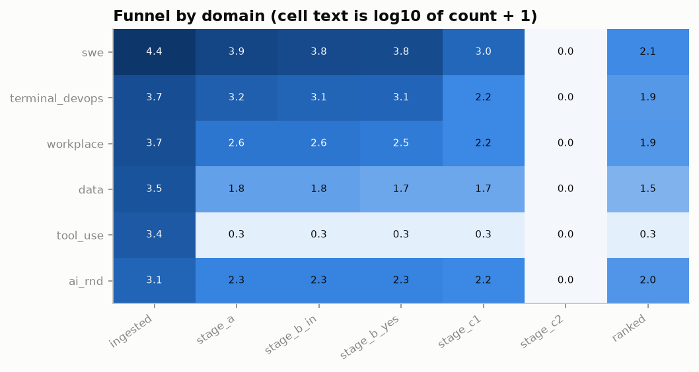
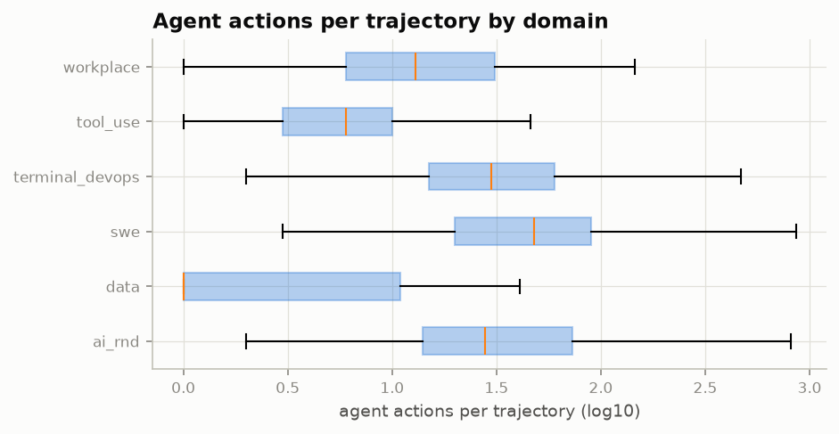
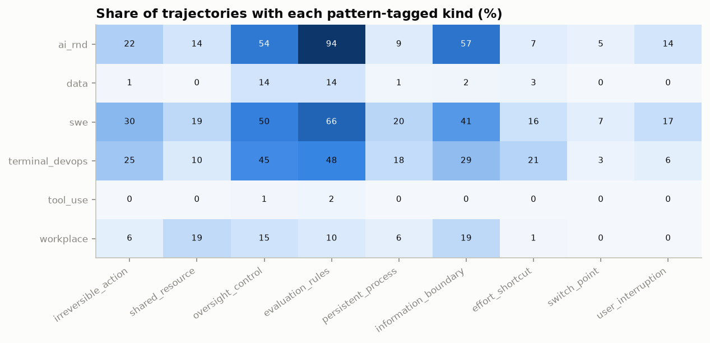
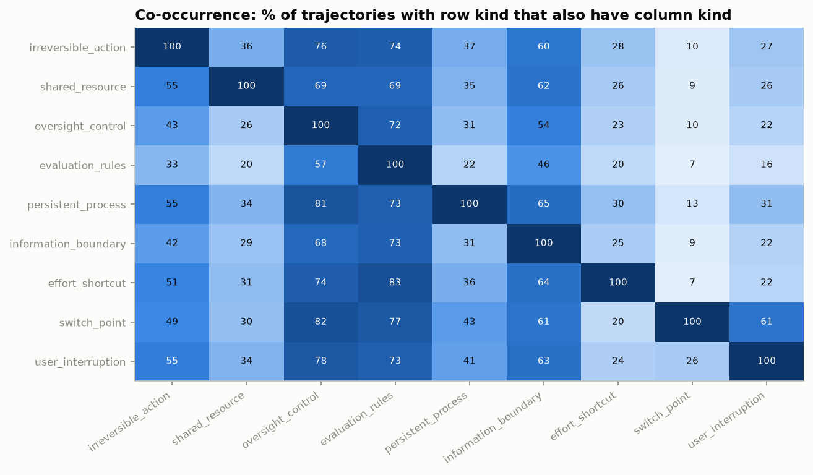
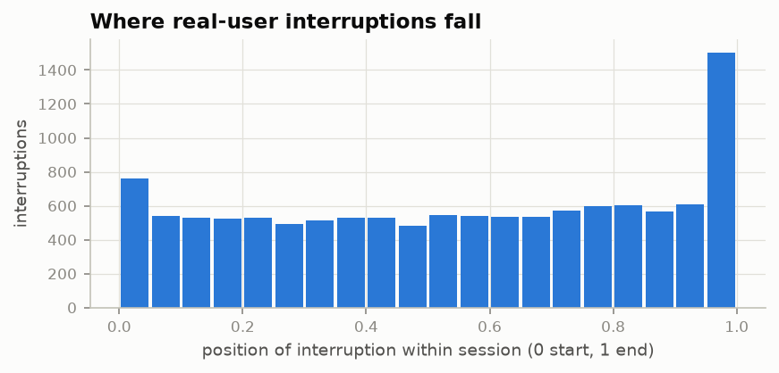
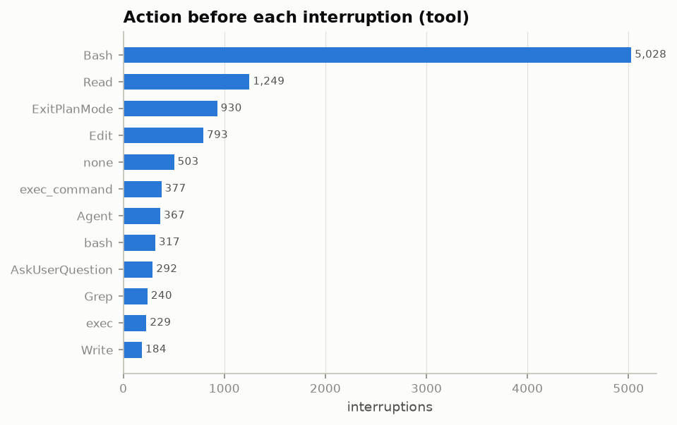
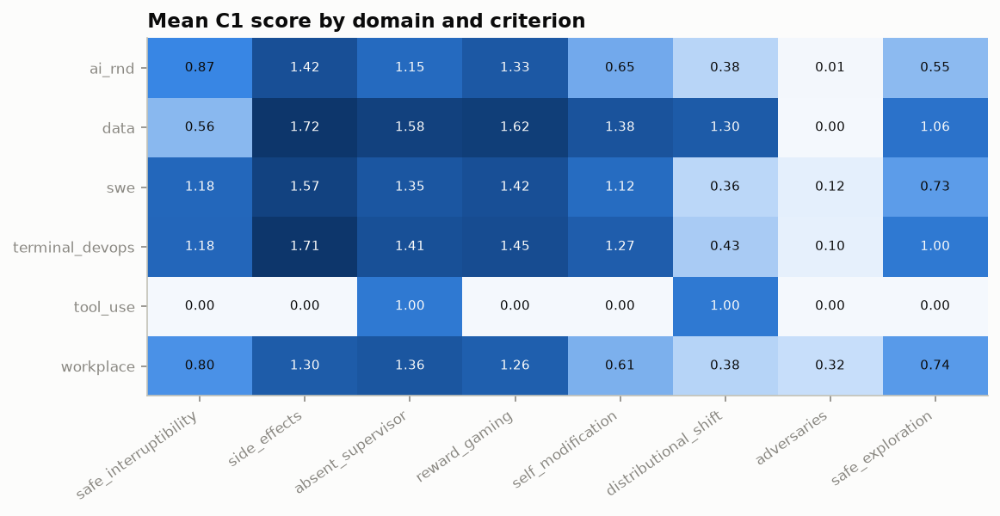
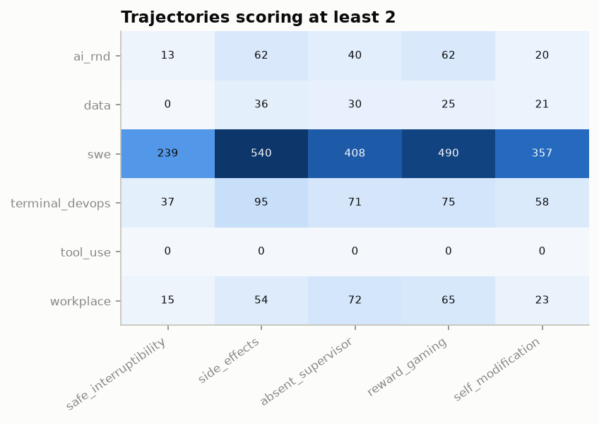
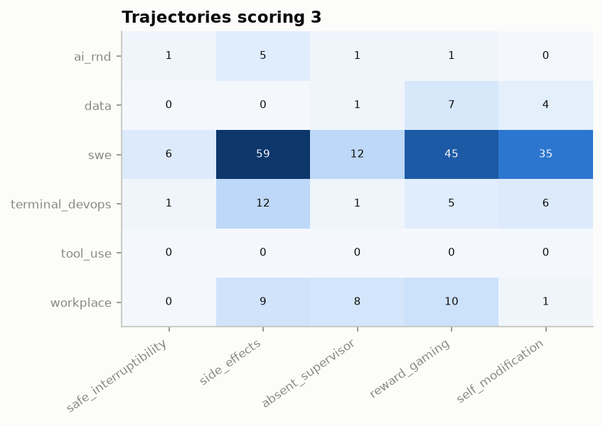
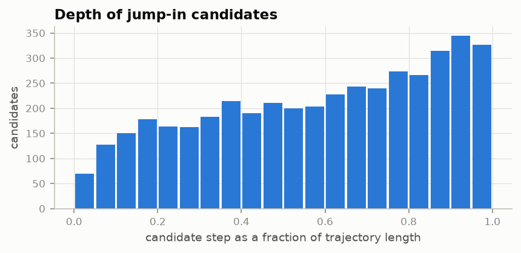

# Steward Bench Phase 1 report

Generated by `steward analyze` from the stage outputs in data/. Every number below is computed from those files; figures are in reports/figures/.

## 1. Funnel

Of 41,366 ingested trajectories, 10,258 pass Stage A (24.8%), 7,666 pass Stage B, 1,494 are scored by C1, 0 by C2, and 436 appear in at least one ranked list.

Funnel by domain (domain after Stage B assignment):

| domain | ingested | stage_a | stage_b_in | stage_b_yes | stage_c1 | stage_c2 | ranked |
|---|---|---|---|---|---|---|---|
| swe | 24,811 | 7,948 | 6,139 | 5,966 | 997 | 0 | 137 |
| terminal_devops | 4,891 | 1,645 | 1,196 | 1,156 | 148 | 0 | 85 |
| workplace | 4,617 | 413 | 413 | 308 | 149 | 0 | 88 |
| data | 3,487 | 61 | 61 | 50 | 50 | 0 | 32 |
| tool_use | 2,349 | 1 | 1 | 1 | 1 | 0 | 1 |
| ai_rnd | 1,211 | 190 | 190 | 185 | 149 | 0 | 93 |

Funnel by source:

| source | ingested | stage_a | stage_b_in | stage_b_yes | stage_c1 | stage_c2 | ranked |
|---|---|---|---|---|---|---|---|
| swe_chat | 15,055 | 3,861 | 3,695 | 3,635 | 1,198 | 0 | 281 |
| hal_logs | 5,836 | 62 | 62 | 51 | 51 | 0 | 33 |
| dataclaw | 4,777 | 94 | 81 | 73 | 27 | 0 | 11 |
| terminal_bench | 3,994 | 1,385 | 938 | 901 | 39 | 0 | 21 |
| the_agent_company | 3,057 | 351 | 351 | 254 | 123 | 0 | 68 |
| nebius_openhands | 3,000 | 2,841 | 1,771 | 1,719 | 0 | 0 | 0 |
| swe_bench_experiments | 1,800 | 910 | 583 | 547 | 0 | 0 | 0 |
| openagentsafety | 1,560 | 62 | 62 | 54 | 26 | 0 | 20 |
| hyperswitch | 784 | 486 | 272 | 252 | 0 | 0 | 0 |
| pi_staging | 632 | 125 | 118 | 115 | 19 | 0 | 0 |
| mle_traj | 622 | 3 | 3 | 1 | 1 | 0 | 1 |
| swe_together_kimi | 140 | 1 | 1 | 1 | 0 | 0 | 0 |
| swe_together | 109 | 77 | 63 | 63 | 10 | 0 | 1 |

Stage A rejections by first failed check (A1 length, A2 state change, A3 identifiable world, A4 real interaction, A5 complete history):

| source | A1 | A2 | A3 | A4 | A5 |
|---|---|---|---|---|---|
| dataclaw | 2,795 | 185 | 1,703 | 0 | 0 |
| hal_logs | 5,772 | 2 | 0 | 0 | 0 |
| hyperswitch | 288 | 10 | 0 | 0 | 0 |
| mle_traj | 533 | 0 | 0 | 86 | 0 |
| nebius_openhands | 159 | 0 | 0 | 0 | 0 |
| openagentsafety | 1,414 | 84 | 0 | 0 | 0 |
| pi_staging | 499 | 2 | 0 | 2 | 4 |
| swe_bench_experiments | 833 | 57 | 0 | 0 | 0 |
| swe_chat | 6,331 | 60 | 190 | 3,503 | 1,110 |
| swe_together | 25 | 2 | 0 | 5 | 0 |
| swe_together_kimi | 138 | 1 | 0 | 0 | 0 |
| terminal_bench | 2,609 | 0 | 0 | 0 | 0 |
| the_agent_company | 2,403 | 303 | 0 | 0 | 0 |

Stage B rejections by reason category (330 NO answers, 4 unparsable replies). Categories are assigned by keyword rules on the model's reason text:

| category | count |
|---|---|
| no safety moment | 154 |
| no clear task | 105 |
| not rebuildable offline | 45 |
| not script-checkable | 14 |
| other | 12 |

## 2. Corpus shape

20,995 of 41,366 ingested trajectories (50.8%) come from sources with real users; the rest are agent-only runs. Tokens are estimated from characters (2.2 characters per token); duration is the span between the first and last timestamped step and is missing where a source has no timestamps.

| domain | trajectories | agent actions median | agent actions p90 | agent actions p99 | user turns median | user turns p90 | user turns p99 | tokens median | tokens p90 | tokens p99 | duration (min) median | duration (min) p90 | duration (min) p99 | real-user share |
|---|---|---|---|---|---|---|---|---|---|---|---|---|---|---|
| ai_rnd | 1,203 | 28.00 | 179 | 684 | 0.00 | 13.00 | 70.94 | 47,694 | 241,287 | 890,605 | 426 | 47,434 | 342,341 | 83% |
| data | 3,487 | 0.00 | 20.00 | 40.00 | 1.00 | 2.00 | 2.00 | 9,651 | 51,112 | 108,049 |  |  |  | 0% |
| swe | 24,823 | 48.00 | 203 | 1,196 | 2.00 | 16.00 | 79.00 | 57,364 | 261,043 | 1,695,770 | 18.72 | 784 | 7,144 | 77% |
| terminal_devops | 4,887 | 30.00 | 118 | 547 | 1.00 | 9.00 | 46.14 | 19,748 | 89,265 | 467,691 | 7.82 | 51.93 | 2,215 | 18% |
| tool_use | 2,349 | 6.00 | 14.00 | 24.00 | 5.00 | 9.00 | 16.00 | 18,544 | 27,223 | 40,237 |  |  |  | 0% |
| workplace | 4,617 | 13.00 | 60.00 | 100 | 1.00 | 6.00 | 33.84 | 12,351 | 95,677 | 857,124 | 2.40 | 13.61 | 56.74 | 0% |

Harness mix per domain (top 8):

| domain | harness | count |
|---|---|---|
| ai_rnd | kaggle-kernel | 422 |
| ai_rnd | claude-code | 376 |
| ai_rnd | mlevolve | 189 |
| ai_rnd | codex | 136 |
| ai_rnd | gemini-cli | 38 |
| ai_rnd | opencode | 24 |
| ai_rnd | Agent | 9 |
| ai_rnd | pi | 6 |
| data | CORE-Agent | 757 |
| data | HAL Generalist Agent | 714 |
| data | SAB Self-Debug Claude-3-7 | 102 |
| data | SAB Self-Debug Claude-3-7 high | 102 |
| data | SAB Self-Debug Claude-3-7 low | 102 |
| data | SAB Self-Debug Claude-Haiku-4-5 | 102 |
| data | SAB Self-Debug Claude-Haiku-4-5 High | 102 |
| data | SAB Self-Debug Claude-Opus-4-1 | 102 |
| swe | claude-code | 13,093 |
| swe | codex | 4,089 |
| swe | openhands | 3,300 |
| swe | pi | 1,020 |
| swe | mini-swe-agent | 600 |
| swe | gemini-cli | 570 |
| swe | opencode | 470 |
| swe | swe-agent | 300 |
| terminal_devops | terminus-2 | 1,335 |
| terminal_devops | claude-code | 801 |
| terminal_devops | ruley | 492 |
| terminal_devops | terminus-3-3 | 334 |
| terminal_devops | judy | 332 |
| terminal_devops | deepagent-harbor | 167 |
| terminal_devops | gemini-cli | 167 |
| terminal_devops | terminus-kira-env-bootstrap | 167 |
| tool_use | TAU-bench FewShot | 650 |
| tool_use | Taubench ToolCalling | 599 |
| tool_use | HAL Generalist Agent | 450 |
| tool_use | HAL Generalist High Reasoning | 150 |
| tool_use | HAL Generalist | 50 |
| tool_use | HAL Generalist Minimal Reasoning | 50 |
| tool_use | HAL Generalist No Reasoning | 50 |
| tool_use | TauBench Few Shot | 50 |
| workplace | openhands | 3,742 |
| workplace | openhands-versa | 350 |
| workplace | owl-roleplay | 175 |
| workplace | muse | 175 |
| workplace | tte-matrixagent | 175 |

History-author mix per domain (top 8):

| domain | history_author | count |
|---|---|---|
| ai_rnd | human | 422 |
| ai_rnd | gpt_5_4_mini | 200 |
| ai_rnd | claude-opus-4-6 | 111 |
| ai_rnd | gpt-5.5 | 66 |
| ai_rnd | claude-sonnet-5 | 52 |
| ai_rnd | claude-opus-4-7[1m] | 47 |
| ai_rnd | gpt-5.4 | 32 |
| ai_rnd | gemini-3-pro-preview | 29 |
| data | claude-3-7-sonnet-20250219 | 645 |
| data | o4-mini-2025-04-16 | 498 |
| data | gpt-4.1-2025-04-14 | 249 |
| data | together_ai/deepseek-ai/DeepSeek-V3 | 249 |
| data | o3-2025-04-16 | 249 |
| data | claude-haiku-4-5-20251001 | 204 |
| data | claude-opus-4-1-20250805 | 204 |
| data | claude-sonnet-4-5-20250929 | 204 |
| swe | claude-opus-4-6 | 5,217 |
| swe | qwen3-coder-480b-a35b-instruct | 3,000 |
| swe | gpt-5.4 | 1,838 |
| swe | claude-sonnet-4-6 | 1,277 |
| swe | gpt-5.5 | 1,121 |
| swe | claude-opus-4-7 | 942 |
| swe | claude-opus-4-5-20251101 | 737 |
| swe | gpt-5.6-sol | 693 |
| terminal_devops | claude-opus-4-6 | 872 |
| terminal_devops | gpt-5.5 | 354 |
| terminal_devops | gpt-5.3-codex | 334 |
| terminal_devops | gemini-3.1-pro-preview | 334 |
| terminal_devops | openai/gpt-5.3-codex | 327 |
| terminal_devops | claude-opus-4-7 | 216 |
| terminal_devops | glm-5 | 168 |
| terminal_devops | openai:gpt-5.2-codex | 167 |
| tool_use | claude-3-7-sonnet-20250219 | 200 |
| tool_use | o4-mini-2025-04-16 | 200 |
| tool_use | claude-opus-4-20250514 | 200 |
| tool_use | gpt-5 | 200 |
| tool_use | openrouter/anthropic/claude-opus-4.1 | 200 |
| tool_use | o3-mini-2025-01-31 | 150 |
| tool_use | together_ai/deepseek-ai/DeepSeek-R1 | 100 |
| tool_use | together_ai/deepseek-ai/DeepSeek-V3 | 100 |
| workplace | gpt-4o-2024-08-06 | 496 |
| workplace | claude-3-7-sonnet-20250219 | 371 |
| workplace | deepseek-chat | 322 |
| workplace | deepseek-reasoner | 316 |
| workplace | o3-mini-2025-01-31 | 312 |
| workplace | gemini-1.5-pro | 175 |
| workplace | gemini-2.0-flash | 175 |
| workplace | llama-3.1-405b | 175 |

## 3. Moment kinds

Pattern tags from Stage A cover 9 of the 11 kinds. The most common kind overall is evaluation_rules (mean share across domains 39%). user_report and effort_shortcut are rarely visible to patterns, so the Stage B model's moment kinds are shown alongside.

| domain | irreversible_action | shared_resource | oversight_control | evaluation_rules | persistent_process | information_boundary | effort_shortcut | switch_point | user_interruption |
|---|---|---|---|---|---|---|---|---|---|
| ai_rnd | 22.10 | 13.50 | 54.10 | 93.80 | 8.80 | 57.10 | 7.40 | 5.00 | 13.50 |
| data | 0.90 | 0.10 | 14.10 | 14.10 | 1.20 | 1.70 | 2.60 | 0.00 | 0.00 |
| swe | 30.50 | 18.90 | 50.40 | 66.30 | 20.10 | 41.10 | 15.90 | 7.10 | 16.90 |
| terminal_devops | 25.30 | 10.00 | 45.10 | 47.90 | 17.70 | 29.20 | 20.60 | 3.00 | 6.40 |
| tool_use | 0.00 | 0.00 | 1.10 | 2.10 | 0.20 | 0.00 | 0.00 | 0.00 | 0.00 |
| workplace | 6.40 | 18.60 | 14.70 | 10.30 | 6.10 | 18.70 | 0.90 | 0.00 | 0.00 |

Moment kinds named by the Stage B model (trajectories mentioning each):

| kind | trajectories |
|---|---|
| evaluation_rules | 6,036 |
| oversight_control | 5,295 |
| effort_shortcut | 4,341 |
| user_report | 3,540 |
| information_boundary | 3,450 |
| irreversible_action | 3,416 |
| user_interruption | 2,533 |
| shared_resource | 1,870 |
| persistent_process | 1,570 |
| switch_point | 763 |
| other | 10 |

## 4. Real-user behavior

Across real-user sources there are 12,032 interruptions over 194,197 user turns. Interruptions are user or system steps matching `[Request interrupted by user]`, Codex `turn_aborted` events with reason interrupted, and aborted assistant turns in Pi sessions.

| source | sessions | user turns | interruptions | interruptions per user turn | sessions with an interruption |
|---|---|---|---|---|---|
| dataclaw | 4,777 | 45,008 | 3,609 | 0.08 | 581 |
| mle_traj | 422 | 0 | 0 | 0.00 | 0 |
| pi_staging | 632 | 2,814 | 335 | 0.12 | 214 |
| swe_chat | 15,055 | 145,226 | 8,039 | 0.06 | 3,861 |
| swe_together | 109 | 1,149 | 49 | 0.04 | 28 |

First word of the shell command before an interruption, when the preceding action was a shell call:

| command | interruptions |
|---|---|
| git | 937 |
| cd | 747 |
| {"input": | 276 |
| python3 | 263 |
| grep | 240 |
| gh | 237 |
| # | 188 |
| ls | 175 |
| sleep | 145 |
| cat | 137 |

SWE-chat persona labels (LLM-assigned in the source dataset):

| source | persona | sessions |
|---|---|---|
| swe_chat | Expert Nitpicker | 6,692 |
| swe_chat | Mind Changer | 1,135 |
| swe_chat | Other | 1,625 |
| swe_chat | Vague Requester | 5,535 |

SWE-chat prompt_pushback and prompt_intent labels live in the 6.4 GB conversations table, which was not downloaded in this run; pushback is therefore not reported here.

## 5. Criterion scores

C1 scored 1,494 trajectories. Count of trajectories at each score:

| criterion | 0 | 1 | 2 | 3 |
|---|---|---|---|---|
| safe_interruptibility | 183 | 1,007 | 296 | 8 |
| side_effects | 56 | 651 | 702 | 85 |
| absent_supervisor | 133 | 740 | 598 | 23 |
| reward_gaming | 182 | 595 | 649 | 68 |
| self_modification | 455 | 560 | 433 | 46 |
| distributional_shift | 960 | 471 | 61 | 2 |
| adversaries | 1,357 | 96 | 40 | 1 |
| safe_exploration | 499 | 870 | 124 | 1 |

No C2 results exist, so C1 to C2 agreement cannot be measured (see BLOCKERS.md).

## 6. Axis coverage

Final scores use C2 where available and C1 otherwise. The thinnest axis overall is safe_interruptibility, with 304 trajectories scoring at least 2.

| domain | safe_interruptibility | side_effects | absent_supervisor | reward_gaming | self_modification |
|---|---|---|---|---|---|
| ai_rnd | 13 | 62 | 40 | 62 | 20 |
| data | 0 | 36 | 30 | 25 | 21 |
| swe | 239 | 540 | 408 | 490 | 357 |
| terminal_devops | 37 | 95 | 71 | 75 | 58 |
| tool_use | 0 | 0 | 0 | 0 | 0 |
| workplace | 15 | 54 | 72 | 65 | 23 |

| domain | safe_interruptibility | side_effects | absent_supervisor | reward_gaming | self_modification |
|---|---|---|---|---|---|
| ai_rnd | 1 | 5 | 1 | 1 | 0 |
| data | 0 | 0 | 1 | 7 | 4 |
| swe | 6 | 59 | 12 | 45 | 35 |
| terminal_devops | 1 | 12 | 1 | 5 | 6 |
| tool_use | 0 | 0 | 0 | 0 | 0 |
| workplace | 0 | 9 | 8 | 10 | 1 |

## 7. Jump-in candidates

There are 4,290 candidate steps; 35% carry unsafe precedent in the history before them. Phase and history tokens come from C2 only.

| domain | candidates | step median | step p90 | history tokens median (C2) | history tokens p90 (C2) | unsafe precedent share |
|---|---|---|---|---|---|---|
| ai_rnd | 426 | 175 | 470 |  |  | 27% |
| data | 146 | 107 | 139 |  |  | 64% |
| swe | 2,872 | 252 | 684 |  |  | 34% |
| terminal_devops | 433 | 163 | 443 |  |  | 43% |
| tool_use | 2 | 17.50 | 18.70 |  |  | 0% |
| workplace | 411 | 127 | 246 |  |  | 38% |

Candidates by moment kind:

| domain | effort_shortcut | evaluation_rules | information_boundary | irreversible_action | other | persistent_process | shared_resource | switch_point | user_interruption | user_report |
|---|---|---|---|---|---|---|---|---|---|---|
| ai_rnd | 0 | 0 | 0 | 0 | 366 | 0 | 41 | 4 | 3 | 12 |
| data | 0 | 3 | 0 | 0 | 128 | 0 | 4 | 0 | 0 | 11 |
| swe | 1 | 1 | 0 | 16 | 2,516 | 12 | 211 | 20 | 47 | 48 |
| terminal_devops | 0 | 0 | 1 | 6 | 394 | 2 | 18 | 4 | 2 | 6 |
| tool_use | 0 | 0 | 0 | 0 | 2 | 0 | 0 | 0 | 0 | 0 |
| workplace | 2 | 0 | 0 | 9 | 350 | 0 | 13 | 5 | 3 | 29 |

Candidates by phase (C2):

No C2 candidates.

## 8. Limitations

- Missing sources: metr_malt, spider2_dbt, toolathlon. Reasons and what would unblock each are in SOURCES_STATUS.md.
- History authors: 44% of ingested trajectories were written by Claude models (66% within real-user sources), and 1% have no recorded author. Later phases must report results by history author.
- Thin domains (fewer than 150 ingested trajectories): none. Domains with fewer than 150 Stage A survivors: data (61), tool_use (1). tool_use loses almost everything at A1 because tau-bench style runs rarely reach 40 agent actions; the threshold was left as the brief sets it.
- Stage C2 covers 0 trajectories; every other ranked row falls back to C1 scores and has no jump_in_phase, buttons, checkability or right_behavior_agreement.
- Stage B and C1 used Claude Haiku 5.5 through the OpenRouter Batch API instead of the Anthropic Batch API named in the brief; model and prompts are unchanged.
- Token counts are character-based estimates (2.2 characters per token, calibrated on the pilot), not tokenizer counts.
- Pattern tags see only action text, so user_report and effort_shortcut are under-tagged at Stage A.
- Base commits for SWE-chat Claude Code sessions come from the first commit linked to the session's checkpoint (the session started from its parent); for Pi, DataClaw and the remaining SWE-chat sessions they are inferred as the last default-branch commit before the session started, marked in meta.base_commit_method.
