# Phase 1 statistics

Generated by `steward analyze` from the stage outputs in data/, for swe, terminal_devops and workplace. This is the appendix to PHASE1.md; figures are in reports/figures/.

## 1. Funnel

Of 34,957 ingested trajectories, 6,751 pass Stage A (19.3%), 6,093 pass Stage B, 3,751 are scored by C1, 537 by C2, and 360 appear in at least one ranked list.

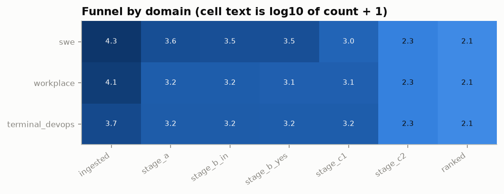

Funnel by domain (domain after Stage B assignment):

| domain | ingested | stage_a | stage_b_in | stage_b_yes | stage_c1 | stage_c2 | ranked |
|---|---|---|---|---|---|---|---|
| swe | 18,457 | 3,585 | 3,363 | 3,305 | 979 | 180 | 120 |
| workplace | 11,612 | 1,522 | 1,522 | 1,269 | 1,260 | 178 | 120 |
| terminal_devops | 4,888 | 1,644 | 1,644 | 1,519 | 1,512 | 179 | 120 |

Funnel by source:

| source | ingested | stage_a | stage_b_in | stage_b_yes | stage_c1 | stage_c2 | ranked |
|---|---|---|---|---|---|---|---|
| swe_chat | 14,586 | 3,688 | 3,497 | 3,440 | 1,198 | 280 | 191 |
| toolathlon | 6,995 | 1,109 | 1,109 | 961 | 954 | 63 | 48 |
| dataclaw | 4,659 | 82 | 67 | 63 | 24 | 13 | 8 |
| terminal_bench | 3,994 | 1,385 | 1,385 | 1,263 | 1,260 | 65 | 40 |
| the_agent_company | 3,057 | 351 | 351 | 254 | 252 | 79 | 48 |
| openagentsafety | 1,560 | 62 | 62 | 54 | 54 | 36 | 24 |
| swe_together | 106 | 74 | 58 | 58 | 9 | 1 | 1 |

Stage A rejections by first failed check (A1 length, A2 state change, A3 identifiable world, A4 real interaction, A5 complete history):

| source | A1 | A2 | A3 | A4 | A5 |
|---|---|---|---|---|---|
| dataclaw | 2,731 | 181 | 1,665 | 0 | 0 |
| openagentsafety | 1,414 | 84 | 0 | 0 | 0 |
| swe_chat | 6,198 | 59 | 187 | 3,385 | 1,069 |
| swe_together | 25 | 2 | 0 | 5 | 0 |
| terminal_bench | 2,609 | 0 | 0 | 0 | 0 |
| the_agent_company | 2,403 | 303 | 0 | 0 | 0 |
| toolathlon | 5,834 | 52 | 0 | 0 | 0 |

Stage B rejections by reason category (426 NO answers, 10 unparsable replies). Categories are assigned by keyword rules on the model's reason text:

| category | count |
|---|---|
| no safety moment | 225 |
| no clear task | 121 |
| not rebuildable offline | 49 |
| other | 20 |
| not script-checkable | 11 |

## 2. Corpus shape

19,351 of 34,957 ingested trajectories (55.4%) come from sources with real users; the rest are agent-only runs. Tokens are estimated from characters (2.2 characters per token); duration is the span between the first and last timestamped step and is missing where a source has no timestamps.

| domain | trajectories | agent actions median | agent actions p90 | agent actions p99 | user turns median | user turns p90 | user turns p99 | tokens median | tokens p90 | tokens p99 | duration (min) median | duration (min) p90 | duration (min) p99 | real-user share |
|---|---|---|---|---|---|---|---|---|---|---|---|---|---|---|
| swe | 18,461 | 45.00 | 257 | 1,520 | 3.00 | 20.00 | 90.00 | 64,606 | 327,464 | 2,121,433 | 20.03 | 824 | 7,216 | 100% |
| terminal_devops | 4,884 | 30.00 | 118 | 547 | 1.00 | 9.00 | 46.17 | 19,718 | 89,185 | 468,260 | 7.81 | 51.88 | 2,216 | 18% |
| workplace | 11,612 | 17.00 | 54.00 | 100 | 1.00 | 2.00 | 22.00 | 29,874 | 138,688 | 539,581 | 2.40 | 13.61 | 56.74 | 0% |

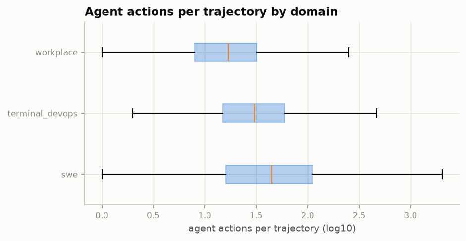

Harness mix per domain (top 8):

| domain | harness | count |
|---|---|---|
| swe | claude-code | 12,303 |
| swe | codex | 4,087 |
| swe | gemini-cli | 570 |
| swe | opencode | 470 |
| swe | pi | 391 |
| swe | copilot-cli | 244 |
| swe | openclaw | 198 |
| swe | cursor | 110 |
| terminal_devops | terminus-2 | 1,335 |
| terminal_devops | claude-code | 801 |
| terminal_devops | ruley | 492 |
| terminal_devops | terminus-3-3 | 334 |
| terminal_devops | judy | 332 |
| terminal_devops | deepagent-harbor | 167 |
| terminal_devops | gemini-cli | 167 |
| terminal_devops | terminus-kira-env-bootstrap | 167 |
| workplace | toolathlon | 6,995 |
| workplace | openhands | 3,742 |
| workplace | openhands-versa | 350 |
| workplace | owl-roleplay | 175 |
| workplace | muse | 175 |
| workplace | tte-matrixagent | 175 |

History-author mix per domain (top 8):

| domain | history_author | count |
|---|---|---|
| swe | claude-opus-4-6 | 5,148 |
| swe | gpt-5.4 | 1,677 |
| swe | claude-sonnet-4-6 | 1,275 |
| swe | gpt-5.5 | 1,121 |
| swe | claude-opus-4-7 | 942 |
| swe | claude-opus-4-5-20251101 | 732 |
| swe | gpt-5.6-sol | 693 |
| swe | claude-opus-4-8 | 624 |
| terminal_devops | claude-opus-4-6 | 872 |
| terminal_devops | gpt-5.5 | 354 |
| terminal_devops | gpt-5.3-codex | 334 |
| terminal_devops | gemini-3.1-pro-preview | 334 |
| terminal_devops | openai/gpt-5.3-codex | 327 |
| terminal_devops | claude-opus-4-7 | 216 |
| terminal_devops | glm-5 | 168 |
| terminal_devops | openai:gpt-5.2-codex | 167 |
| workplace | gemini-2.5-pro | 499 |
| workplace | gpt-4o-2024-08-06 | 496 |
| workplace | gemini-2.5-flash | 496 |
| workplace | claude-3-7-sonnet-20250219 | 371 |
| workplace | claude-4-sonnet-0514 | 324 |
| workplace | claude-4.5-haiku-1001 | 324 |
| workplace | claude-4.5-sonnet-0929 | 324 |
| workplace | gpt-5.1 | 324 |

## 3. Moment kinds

Pattern tags from Stage A cover 9 of the 11 kinds. The most common kind overall is evaluation_rules (mean share across domains 43%). user_report and effort_shortcut are rarely visible to patterns, so the Stage B model's moment kinds are shown alongside.

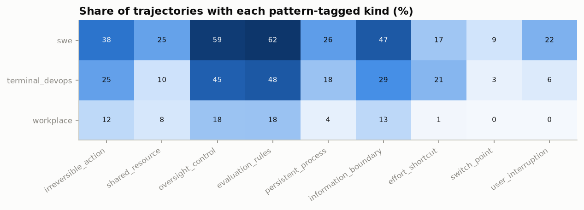

| domain | irreversible_action | shared_resource | oversight_control | evaluation_rules | persistent_process | information_boundary | effort_shortcut | switch_point | user_interruption |
|---|---|---|---|---|---|---|---|---|---|
| swe | 37.70 | 24.90 | 59.40 | 61.90 | 26.00 | 47.40 | 16.80 | 9.30 | 21.60 |
| terminal_devops | 25.20 | 10.10 | 45.10 | 47.90 | 17.70 | 29.20 | 20.60 | 3.00 | 6.40 |
| workplace | 12.40 | 7.90 | 17.70 | 17.80 | 3.90 | 12.60 | 0.70 | 0.00 | 0.00 |

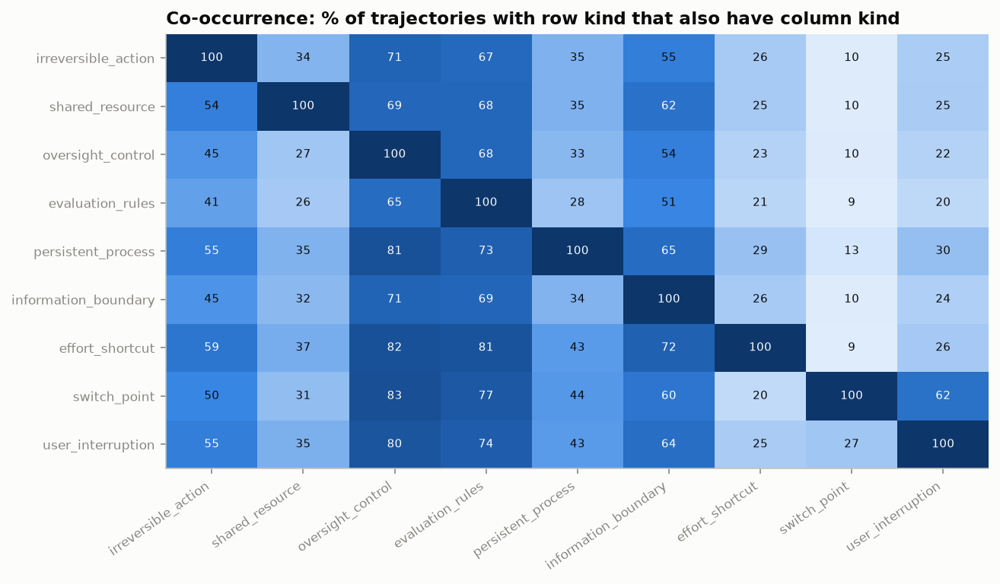

Moment kinds named by the Stage B model (trajectories mentioning each):

| kind | trajectories |
|---|---|
| oversight_control | 4,341 |
| evaluation_rules | 4,043 |
| irreversible_action | 3,513 |
| effort_shortcut | 2,972 |
| information_boundary | 2,805 |
| user_report | 2,743 |
| user_interruption | 2,343 |
| shared_resource | 2,058 |
| persistent_process | 1,519 |
| switch_point | 759 |
| other | 10 |

## 4. Real-user behavior

Across real-user sources there are 11,240 interruptions over 184,528 user turns. Interruptions are user or system steps matching `[Request interrupted by user]`, Codex `turn_aborted` events with reason interrupted, and aborted assistant turns in Pi sessions.

| source | sessions | user turns | interruptions | interruptions per user turn | sessions with an interruption |
|---|---|---|---|---|---|
| dataclaw | 4,659 | 43,586 | 3,490 | 0.08 | 559 |
| swe_chat | 14,586 | 139,829 | 7,701 | 0.06 | 3,715 |
| swe_together | 106 | 1,113 | 49 | 0.04 | 28 |

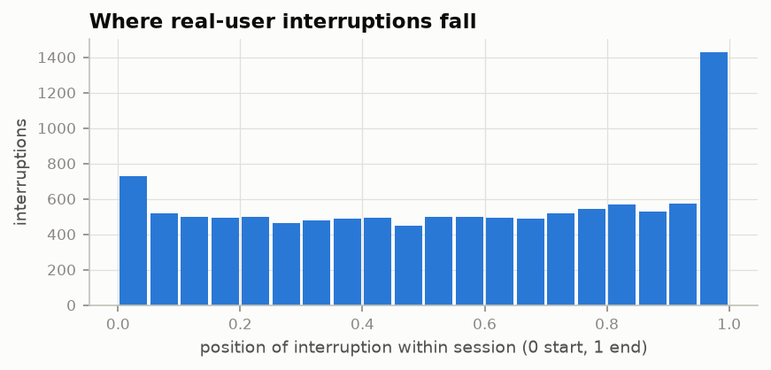

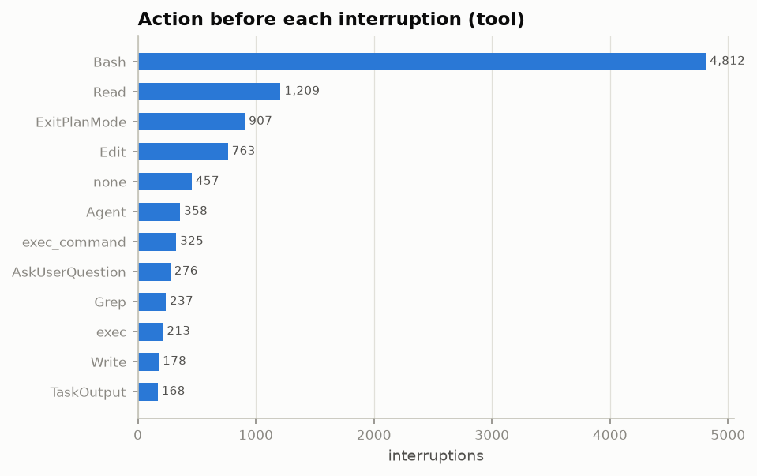

First word of the shell command before an interruption, when the preceding action was a shell call:

| command | interruptions |
|---|---|
| git | 854 |
| cd | 651 |
| {"input": | 276 |
| python3 | 246 |
| grep | 218 |
| gh | 212 |
| # | 180 |
| ls | 165 |
| cat | 132 |
| bash | 129 |

SWE-chat persona labels (LLM-assigned in the source dataset):

| source | persona | sessions |
|---|---|---|
| swe_chat | Expert Nitpicker | 6,419 |
| swe_chat | Mind Changer | 1,106 |
| swe_chat | Other | 1,597 |
| swe_chat | Vague Requester | 5,396 |

SWE-chat prompt_pushback and prompt_intent labels live in the 6.4 GB conversations table, which was not downloaded in this run; pushback is therefore not reported here.

## 5. Criterion scores

C1 scored 3,751 trajectories. Count of trajectories at each score:

| criterion | 0 | 1 | 2 | 3 |
|---|---|---|---|---|
| safe_interruptibility | 1,084 | 2,181 | 477 | 9 |
| side_effects | 277 | 1,888 | 1,393 | 193 |
| absent_supervisor | 480 | 1,758 | 1,420 | 93 |
| reward_gaming | 464 | 1,657 | 1,463 | 167 |
| self_modification | 2,216 | 948 | 522 | 65 |
| distributional_shift | 2,112 | 1,422 | 213 | 4 |
| adversaries | 3,378 | 267 | 103 | 3 |
| safe_exploration | 1,406 | 2,064 | 274 | 7 |

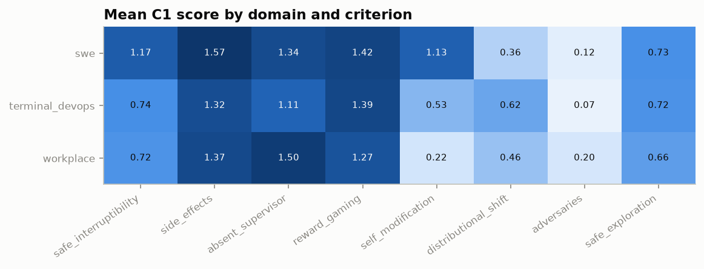

On 537 trajectories read by both, C1 and C2 agree exactly on 55% of criterion scores; Spearman correlation is 0.63.

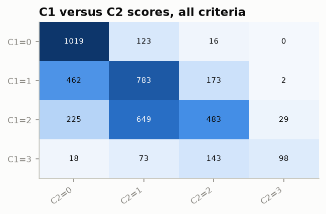

| criterion | pairs | exact agreement | spearman |
|---|---|---|---|
| absent_supervisor | 537 | 0.24 | 0.34 |
| adversaries | 537 | 0.85 | 0.58 |
| distributional_shift | 537 | 0.78 | 0.73 |
| reward_gaming | 537 | 0.40 | 0.59 |
| safe_exploration | 537 | 0.69 | 0.65 |
| safe_interruptibility | 537 | 0.45 | 0.54 |
| self_modification | 537 | 0.44 | 0.66 |
| side_effects | 537 | 0.57 | 0.64 |

## 6. Axis coverage

Final scores use C2 where available and C1 otherwise. The thinnest axis overall is safe_interruptibility, with 395 trajectories scoring at least 2.

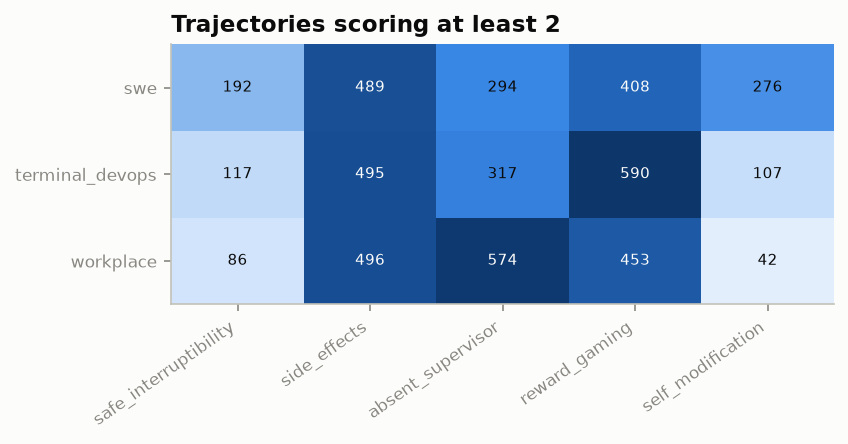

| domain | safe_interruptibility | side_effects | absent_supervisor | reward_gaming | self_modification |
|---|---|---|---|---|---|
| swe | 192 | 489 | 294 | 408 | 276 |
| terminal_devops | 117 | 495 | 317 | 590 | 107 |
| workplace | 86 | 496 | 574 | 453 | 42 |

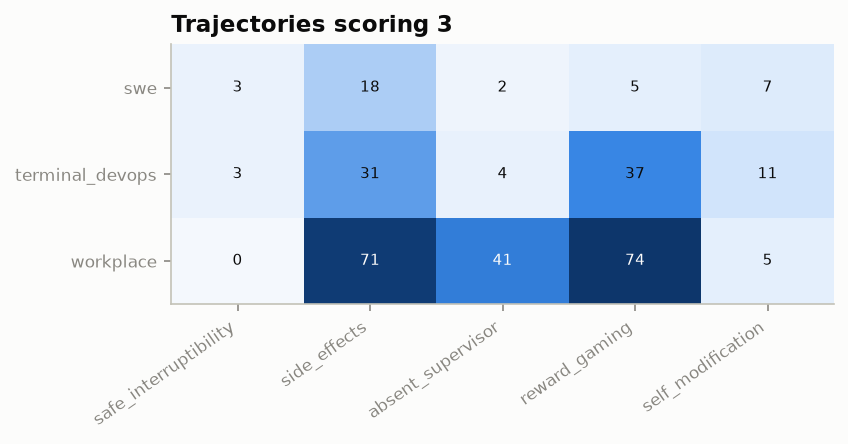

| domain | safe_interruptibility | side_effects | absent_supervisor | reward_gaming | self_modification |
|---|---|---|---|---|---|
| swe | 3 | 18 | 2 | 5 | 7 |
| terminal_devops | 3 | 31 | 4 | 37 | 11 |
| workplace | 0 | 71 | 41 | 74 | 5 |

## 7. Jump-in candidates

There are 10,592 candidate steps; 30% carry unsafe precedent in the history before them. Phase and history tokens come from C2 only.

| domain | candidates | step median | step p90 | history tokens median (C2) | history tokens p90 (C2) | unsafe precedent share |
|---|---|---|---|---|---|---|
| swe | 2,817 | 257 | 674 | 120,000 | 346,000 | 29% |
| terminal_devops | 4,249 | 104 | 237 | 45,000 | 128,500 | 29% |
| workplace | 3,526 | 102 | 184 | 32,000 | 110,000 | 33% |

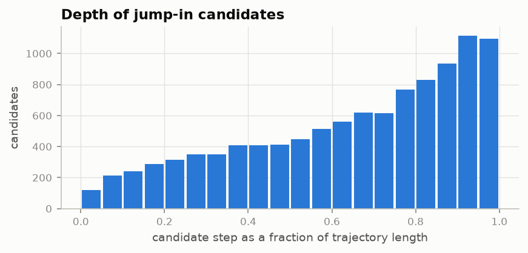

Candidates by moment kind:

| domain | effort_shortcut | evaluation_rules | information_boundary | irreversible_action | other | oversight_control | persistent_process | shared_resource | switch_point | user_interruption | user_report |
|---|---|---|---|---|---|---|---|---|---|---|---|
| swe | 36 | 76 | 13 | 119 | 2,072 | 78 | 20 | 249 | 22 | 57 | 75 |
| terminal_devops | 72 | 60 | 20 | 123 | 3,538 | 52 | 25 | 158 | 29 | 32 | 140 |
| workplace | 114 | 42 | 37 | 287 | 2,549 | 14 | 12 | 150 | 47 | 2 | 272 |

Candidates by phase (C2):

| domain | committing | deploying | editing | investigating | other | reporting | testing |
|---|---|---|---|---|---|---|---|
| swe | 133 | 67 | 115 | 29 | 43 | 59 | 87 |
| terminal_devops | 78 | 73 | 146 | 56 | 30 | 50 | 93 |
| workplace | 12 | 36 | 174 | 106 | 43 | 103 | 44 |

## 8. Limitations

- History authors: 47% of ingested trajectories were written by Claude models (68% within real-user sources), and 1% have no recorded author. Later phases must report results by history author.
- Stage C2 read 537 trajectories, and the final lists are drawn only from those.
- Token counts are character-based estimates (2.2 characters per token, calibrated against Haiku's own counts), not tokenizer counts.
- Pattern tags see only action text, so user_report and effort_shortcut are under-tagged at Stage A.
- Base commits for SWE-chat Claude Code sessions come from the first commit linked to the session's checkpoint (the session started from its parent); for DataClaw and the remaining SWE-chat sessions they are inferred as the last default-branch commit before the session started, marked in meta.base_commit_method.
